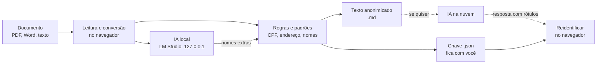

# Anonimizador Local com IA

**Anonimize processos e documentos jurídicos no seu próprio computador, com IA local, antes de usar qualquer IA na nuvem.**

Um projeto focado em segurança, pensado para o **advogado autônomo**: quem cuida sozinho do sigilo dos clientes, não tem equipe de TI e precisa de uma ferramenta que funcione sem servidor, sem conta, sem assinatura e sem enviar documento nenhum para a internet.

É um único arquivo HTML. Abre com dois cliques no navegador, funciona offline e conversa apenas com uma IA que roda na sua máquina, pelo [LM Studio](https://lmstudio.ai).

---

## Por que este projeto existe

Ferramentas de IA na nuvem ajudam muito na redação e na análise, mas colar um processo inteiro nelas expõe nomes, CPFs, endereços e fatos dos clientes. Para o advogado, isso esbarra no **sigilo profissional** e na **LGPD**.

A saída mais segura é simples: **tirar os dados pessoais antes**, aqui no computador, e só então usar a IA externa. Depois, trocar os rótulos de volta pelos dados verdadeiros, também localmente.

O Anonimizador faz exatamente isso, com três camadas:

1. **Regras** (expressões regulares) para dados com formato conhecido: CPF, CNPJ, RG, CNH, RENAVAM, placa, telefone, e-mail, endereço, CEP, conta bancária, data de nascimento, número de processo e OAB.
2. **Detecção de nomes** pelos padrões do texto jurídico: "Autor:", "Réu:", qualificação ("FULANO DE TAL, brasileiro, casado..."), "NOME - CPF" (certidões do eproc).
3. **IA local** como segunda passada: um modelo de linguagem rodando no LM Studio lê o documento em trechos e aponta pessoas que as regras não pegam (primeiro nome sozinho, testemunhas, apelidos).

## O que ele faz

- Converte **PDF, Word (.docx), HTML, TXT e MD** em **Markdown** ou texto simples. Títulos, parágrafos, listas e tabelas são preservados, e cabeçalhos e rodapés repetidos são removidos.
- Substitui cada dado por um **rótulo numerado e consistente**: `[NOME 1]`, `[CPF 1]`, `[ENDERECO 1]`... A mesma pessoa recebe sempre o mesmo rótulo.
- Gera uma **chave de reidentificação** (arquivo `.json`) que liga cada rótulo ao dado verdadeiro. A chave fica com você e nunca vai no texto.
- **Reidentifica**: cole a resposta de outra IA e os rótulos voltam a ser os dados reais, no seu computador.
- **Pacote**: junta vários arquivos num documento só, com rótulos comuns e uma chave.
- Mostra, para revisão, os **nomes achados pela IA** e os **possíveis nomes que ficaram visíveis**.

## Como funciona

Tudo o que está à esquerda da linha pontilhada acontece **no seu computador**. O único endereço com que a página conversa é o do LM Studio, em `127.0.0.1` (a própria máquina).

## Início rápido

1. **Baixe** o arquivo [`Anonimizador_IA.html`](Anonimizador_IA.html) e abra com dois cliques, no Chrome ou no Edge.
2. **(Opcional, recomendado)** Instale o LM Studio, baixe um modelo e ligue o servidor local: veja [docs/LM_STUDIO.md](docs/LM_STUDIO.md). Sem a IA, o Anonimizador funciona só com as regras.
3. **Escolha os arquivos**, clique em **Processar**, revise a prévia e baixe o resultado **e a chave**.

Qual computador e qual modelo usar: [docs/HARDWARE_E_MODELOS.md](docs/HARDWARE_E_MODELOS.md).

## Uso passo a passo

1. Abra `Anonimizador_IA.html`. O selo no canto superior mostra **"IA local: conectada"** ou **"desligada"**.
2. Arraste os arquivos para a área indicada (ou clique para escolher).
3. Em **Opções**:
   - escolha Markdown ou texto;
   - marque o que deve ser ocultado (número do processo e OAB vêm desmarcados);
   - deixe marcada **"Usar a IA local"**;
   - marque **"Juntar todos os arquivos num único pacote"** se for enviar tudo junto;
   - em **"Outros nomes para ocultar"**, coloque nomes que você já sabe que precisam sair.
4. Clique em **Processar**. A IA lê o documento em trechos; com placa de vídeo, são poucos segundos por página.
5. **Revise**:
   - **Nomes achados pela IA**: desmarque o que não for pessoa e clique em **Refazer** (a IA não lê de novo);
   - **Possíveis nomes que ficaram visíveis**: marque os que devem sair e clique em **Ocultar os marcados e refazer**;
   - a **prévia** do texto final.
6. Baixe o **resultado** e a **chave (.json)**.
7. Para desfazer a anonimização de uma resposta: aba **Reidentificar**, escolha a chave (da sessão ou o arquivo `.json`), cole o texto e clique em **Reidentificar**.

## Segurança em resumo

- **Nenhum documento sai do computador.** A leitura, a conversão, a anonimização e a reidentificação rodam no navegador.
- **Funciona offline.** Os leitores de PDF ([pdf.js](https://github.com/mozilla/pdf.js) 3.11.174) e Word ([mammoth](https://github.com/mwilliamson/mammoth.js) 1.8.0) estão embutidos no arquivo, e o Anonimizador confere a impressão digital SHA-512 de cada um antes de executar. Se o arquivo for adulterado, o leitor não roda.
- **A IA é local.** O LM Studio deve escutar só em `127.0.0.1`, e a IA só pode **acrescentar** nomes que aparecem de fato no texto.
- **A chave é sua.** Ela contém os dados verdadeiros, fica só na memória da página e no `.json` que você baixar. Nada é guardado no navegador além da configuração da IA (endereço e modelo).
- **Desligue o registro de conteúdo do LM Studio** (veja [docs/LM_STUDIO.md](docs/LM_STUDIO.md)). Por padrão ele pode gravar as mensagens em arquivos de log, sem criptografia.

Detalhes, modelo de ameaça e boas práticas: [docs/SEGURANCA.md](docs/SEGURANCA.md).

## Limitações

- **A anonimização é automática e pode falhar.** Apelidos raros, sobrenomes isolados e fatos muito específicos (data e local exatos, valores incomuns) podem identificar alguém. **Revise sempre antes de compartilhar.**
- **PDF digitalizado (só imagem) não é lido.** Não há OCR; o Anonimizador avisa quais páginas ficaram sem texto.
- **Arquivo .doc (Word antigo) não é aceito.** Salve como .docx.
- **Juridicamente, é pseudonimização.** Como você guarda a chave, os dados ainda são pessoais para a LGPD, mas quem recebe só o texto não consegue reverter.
- A IA local é um modelo pequeno: ela ajuda a achar nomes, mas não substitui a sua revisão.

## Perguntas frequentes

**Preciso de internet?** Não. Nem para abrir, nem para ler PDF e Word, nem para a IA local.

**Preciso de placa de vídeo?** Não para as regras. Para a IA local, ajuda muito: com uma placa NVIDIA de 6 GB, a leitura de um processo fica de 3 a 50 vezes mais rápida do que só no processador. Veja [docs/HARDWARE_E_MODELOS.md](docs/HARDWARE_E_MODELOS.md).

**O selo diz "IA local: desligada".** Abra o LM Studio, carregue (ou deixe disponível) um modelo e ligue o servidor local com CORS. Detalhes em [docs/LM_STUDIO.md](docs/LM_STUDIO.md).

**Perdi a chave.** O texto anonimizado continua utilizável, mas não pode mais ser reidentificado automaticamente. Por isso, baixe sempre o `.json`.

**Posso usar com qualquer IA na nuvem?** Sim. O texto anonimizado traz uma instrução no topo pedindo que os rótulos sejam mantidos, o que facilita a reidentificação da resposta.

## Aviso

Esta é uma ferramenta de apoio. Ela não constitui aconselhamento jurídico nem garante anonimização completa, e é fornecida "no estado em que se encontra", sem garantias, nos termos da licença. A responsabilidade pela revisão do material antes de qualquer compartilhamento é de quem o compartilha.

## Licença e créditos

Copyright 2026 Daniel Fleischer Jardim.

Distribuído sob a [Licença Apache 2.0](LICENSE).

Inclui, embutidos e sem modificação:
- [pdf.js](https://github.com/mozilla/pdf.js) 3.11.174, Mozilla Foundation, Apache 2.0 ([licença](licencas/pdfjs-LICENSE.txt));
- [mammoth.js](https://github.com/mwilliamson/mammoth.js) 1.8.0, Michael Williamson, BSD 2-Clause ([licença](licencas/mammoth-LICENSE.txt)).

Veja [NOTICE](NOTICE) e [TERCEIROS.md](TERCEIROS.md).
